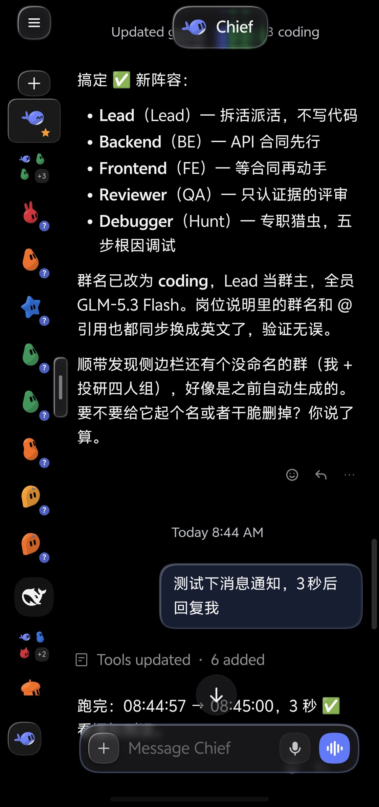
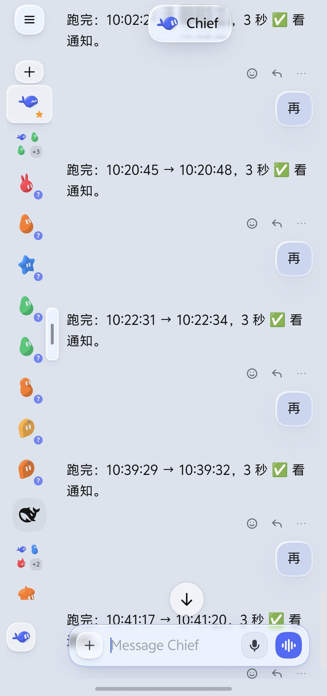
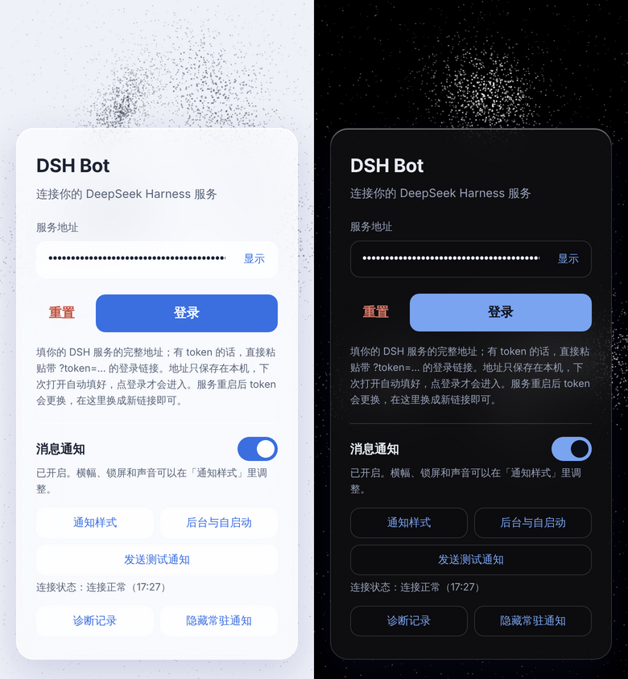

<p align="center">
  
</p>

<h1 align="center">DSH Bot 安卓客户端</h1>

<p align="center">
  <a href="https://github.com/24mlight/dsh-bot-android/releases/latest"></a>
  <a href="https://github.com/24mlight/dsh-bot-android/actions/workflows/android.yml"></a>
  
  
  <a href="LICENSE"></a>
</p>

<p align="center"><a href="README.md">English</a> · <b>简体中文</b></p>

给你自己部署的 [DeepSeek Harness](https://www.npmjs.com/package/@deepseek-ai/dsh)（DSH）用的安卓 App。
- **全屏打开：** 全屏打开你的 DSH 网页界面，配合 Liquid Glass（液态玻璃）皮肤，适配手机屏幕和深浅色模式。
- **消息通知：** 对话回复完成、或者需要你回答问题时，用横幅和锁屏通知提醒你，App 关着也能收到。

App 不绑定任何服务器：第一次填一次你的服务地址，之后就连那一台。

<p align="center">
  
  &nbsp;&nbsp;
  
</p>

## 需要准备

1. **一台能从公网访问的 DSH web 服务器**：见下面的[服务地址](#服务地址)。
2. **服务器上装两个插件**：液态玻璃皮肤和 dsh-notify，见[服务器插件](#服务器插件)。
3. **一部安卓手机**：安卓 10 及以上。

## 服务地址

App 里填的地址必须是运行 `dsh web` 那台机器的**公网地址**。手机在哪都要用它：
- 用流量时；
- 连别的 Wi-Fi 时；
- 后台服务接收通知时。

像 `http://192.168.1.20:8080` 这样的局域网地址只在家里能用，一出门通知就断了。

推荐的做法是：**自己注册一个域名，用 Cloudflare Tunnel（隧道）接到这台机器上**。这样有 HTTPS，不用在路由器上开端口，也不需要固定 IP。

1. **注册域名并接入 Cloudflare：** 在任意注册商注册一个域名，Cloudflare 自己也卖域名，然后把它添加到 Cloudflare。
2. **创建隧道：** 在 DSH 那台机器上安装 [`cloudflared`](https://developers.cloudflare.com/cloudflare-one/connections/connect-networks/downloads/)，然后执行：

   ```bash
   cloudflared tunnel login
   cloudflared tunnel create dsh
   cloudflared tunnel route dns dsh dsh.example.com
   ```

3. **让隧道指向 DSH web 的端口：** 在 `~/.cloudflared/config.yml` 里配置。下面用的是 `8080`，对应 `dsh --profile web --port 8080`：

   ```yaml
   tunnel: <隧道 ID>
   credentials-file: /root/.cloudflared/<隧道 ID>.json
   ingress:
     - hostname: dsh.example.com
       service: http://localhost:8080
     - service: http_status:404
   ```

4. **装成系统服务：** 执行 `cloudflared service install`。想先试一下，可以用 `cloudflared tunnel run dsh`。

完成后你的地址就是 `https://dsh.example.com`。用手机流量在浏览器里打开一次，确认能访问。

### 建议：开启登录 token

地址放到公网后，任何知道它的人都能打开你的 DSH，而 DSH 可以在那台机器上执行命令。所以建议让 DSH web 必须带登录 token 才能访问，只有带 `?token=…` 的链接才能进。App 有没有 token 都能用，但强烈建议加上。

不确定你的 DSH 版本和部署方式该怎么配，可以在那台机器上让 coding agent（Claude Code、Codex、Cursor 等）帮你配，比如这样说：

```text
我的 DSH web（dsh --profile web）通过 Cloudflare Tunnel 暴露在公网上。
帮我把它配置成必须带登录 token 才能访问，保持作为系统服务运行，
最后把带 ?token=… 的登录链接给我。
```

## 服务器插件

两个插件都是**必装**的，装在服务器上的 DSH web profile 里。在运行 `dsh web` 的机器上执行下面的命令（需要有 `git`），把 `web` 换成你自己的 profile 名：

```bash
# 必装：液态玻璃皮肤（App 的界面样式）
dsh plugin --profile web add github:24mlight/dsh-liquid-glass

# 必装：dsh-notify（App 的消息通知）
dsh plugin --profile web add github:24mlight/dsh-notify-plugin

# 可选：ds-bot 多 Bot 插件（Bot 和群聊）
dsh plugin --profile web add ds-bot

systemctl restart dsh-web
```

重启 DSH 用你平时的方式就行，用 systemd 部署的就是 `systemctl restart dsh-web`。

- [dsh-liquid-glass](https://github.com/24mlight/dsh-liquid-glass)：苹果风格的液态玻璃皮肤，适配了 ds-bot 和本 App 的 WebView。包名是 `dsh-glass-skin`。
- [dsh-notify-plugin](https://github.com/24mlight/dsh-notify-plugin)：回复好了就通知 App。包名是 `dsh-notify`。

以后更新插件：

```bash
dsh plugin --profile web update dsh-glass-skin
dsh plugin --profile web update dsh-notify
systemctl restart dsh-web
```

## 安装 App

在 [Releases](https://github.com/24mlight/dsh-bot-android/releases/latest) 下载最新的 `dsh-bot-vX.Y.Z.apk` 安装即可。第一次安装时，安卓会要求你允许浏览器或文件管理器安装应用。新版本直接覆盖安装，登录信息会保留。

## 登录

1. 复制你的 DSH web 地址。开了登录 token 的（推荐），复制带 `?token=…` 的完整登录链接。
2. 打开 DSH Bot，粘贴到「服务地址」，点「登录」。



地址只保存在手机上。token 变了的话（比如 DSH 重启后），在 App 里按返回键回到登录页，粘贴新链接重新登录就行。

## 消息通知

在登录页打开「消息通知」开关。安卓 13 及以上会弹出通知权限申请。然后：

- **后台与自启动：** 允许 App 在后台运行。
  - ColorOS / 一加、MIUI / HyperOS、OriginOS、EMUI 这类电池管理很严的系统，还要进 App 的**电池（耗电管理）**设置，把后台行为**全部允许**，并打开自启动。
  - 不这样设置的话，你一离开 App，系统几秒内就会把它冻结，通知要等你再打开 App 才会到。
- **通知样式：** 横幅、锁屏和声音在系统设置里按类别调整。
- **发送测试通知：** 让服务器走完整条链路发一条通知。
- **诊断记录：** 显示两部分，都带时间。漏了通知时用它排查。
  - 服务器对最近几次回复的判断：发了，或者为什么没发。
  - 手机收到了什么。
- **没有常驻通知：** 后台服务自己不挂任何通知，状态栏和通知栏里都不会出现。代价是它依赖上面的「允许后台运行」；不允许的话，只有 App 开着时才收得到通知。

什么时候会推送：

| 场景 | 什么时候通知 |
|---|---|
| Bot 单聊 | Bot 每次回复（回复失败也会通知） |
| 群聊（ds-bot） | 成员每发一条消息 |
| DSH Agent 或普通 DSH 会话 | 你（或定时任务）发起的一轮结束时 |
| 任何对话 | Bot 向你提问（`ask_user`）时 |

Bot 之间的内部沟通、子 agent、被停止的回复和空回复不会通知。

原理：
- **长轮询：** App 运行一个后台服务（自己不挂通知），用和 WebView 相同的登录 cookie，对 `POST /api/dsh-notify` 保持长轮询。
- **手机休眠时：** 等待和超时检测用 `AlarmManager` 计时，手机休眠时也不会停。
- **自动拉起：** 手机重启或 App 更新后，服务会自动重新启动。

## 从源码构建

```bash
npm ci
node --test              # 单元测试
npx cap sync android
cd android && ./gradlew assembleDebug
```

Capacitor 8，compileSdk 36，minSdk 29，JDK 21。

```
www/                    登录页（一个地址输入框，加上通知设置）
android/                原生工程：DshNavPlugin（打开你的服务器并让它留在 App 里）、
                        NotifyService + DshNotifyPlugin（消息通知）
docs/icon/              App 图标源文件（Orbit：圆环里跳出一个点）
.github/workflows/      CI：跑测试、打包签名 APK、发布 GitHub Release
```

正式版在 CI 里签名，用的是仓库的四个 secret：
- `ANDROID_KEYSTORE_BASE64`：PKCS12 keystore 文件的 base64；
- `ANDROID_KEYSTORE_PASSWORD`；
- `ANDROID_KEY_ALIAS`；
- `ANDROID_KEY_PASSWORD`。

运行 **Android APK** 工作流并填写 `release_tag`（例如 `v0.1.19`），就会发布一个 Release。Fork 需要用自己的 keystore，所以它打出来的 APK 不能覆盖安装这里的版本。

## 推荐搭配

- **[dsh-liquid-glass](https://github.com/24mlight/dsh-liquid-glass)：** 苹果风格的液态玻璃皮肤，电脑浏览器里用 DSH 也很好看。
- **[ds-bot](https://www.npmjs.com/package/ds-bot)：** 多 Bot 插件，可以在 DSH 里建多个 Bot 和群聊。装上后 App 里也能用，Bot 的回复和群聊消息都会推送通知。

安装命令都在上面的[服务器插件](#服务器插件)里。

## 许可证

[GNU GPL v3](LICENSE)。你可以自由使用、研究、修改和分享这个 App；如果你分发它或修改后的版本，必须同样以 GPL v3 公开全部源代码。
